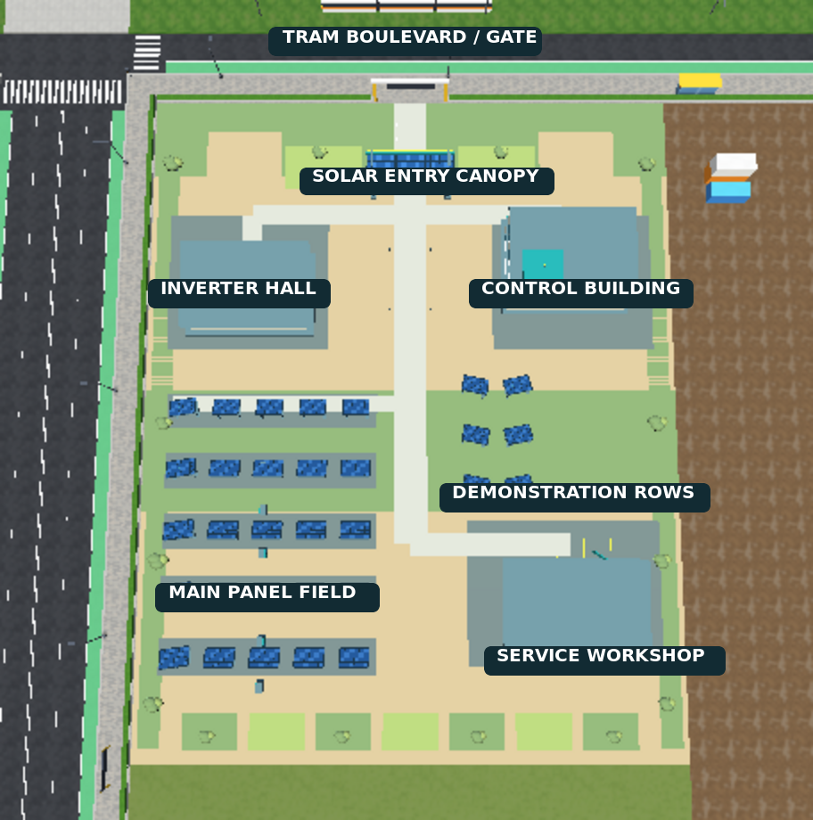
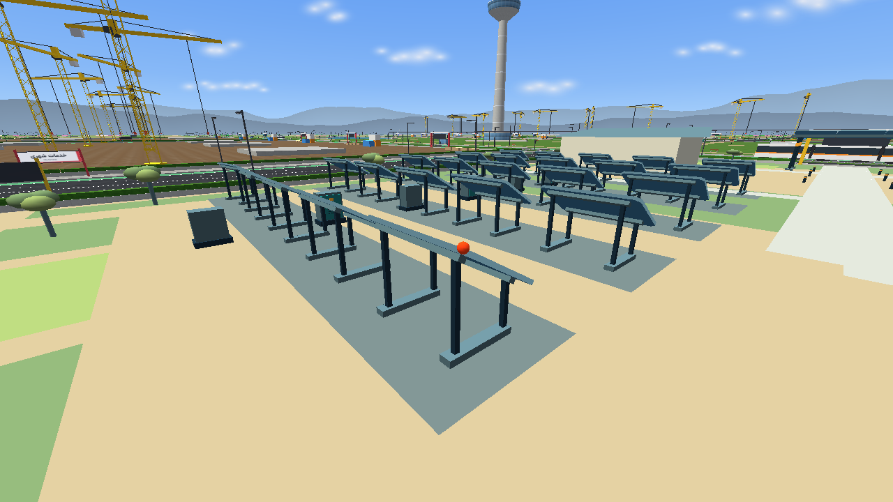

# Team 25 · Solar Power Plant

## Members

| Name | Student ID | GitHub |
|---|---|---|
| Erfan Salman Taheri | 40231416 | estaheri7 |
| Ali Noroozi | 40231052 | aliaw320 |

## Phase 1 · Build the Plot

**EN-1 · Energy & Industry · 80 × 100 m · Solar Power Plant (`solar-plant`)**

The plant is arranged around a pedestrian spine from Tram Boulevard. A solar canopy marks the entry and draws visitors between the two-storey control building and the inverter hall. The spine then opens onto a demonstration garden, a 25-rack production field and a service workshop. Gravel, paving, planted strips and a marked service apron separate public paths from equipment areas. The roofs, solar cells, cabinets and landscape are built in C++ with classic OpenGL geometry.



The gate at the top of the plan is on the plot's local +z edge. The city supplies the sign and street. Within the plot, the path forks to the control building and inverter hall, then continues to the workshop apron and along the panel field.

## Minimum requirements

All implementation references below are in [src/MyZone.cpp](src/MyZone.cpp).

| Requirement | Result | Implementation |
|---|---|---|
| Whole plot and connected paths | The full 80 × 100 m surface is divided into building courts, tree and planting strips, panel pads, and connected paths. The layout breaks up open ground with paving, landscaping or equipment at intervals below the 20 × 20 m empty-area threshold. | `Site`, `drawGrounds`, `registerColliders` |
| Main structures | Control building, inverter hall, and workshop. They have 107, 22, and 14 separately drawn parts respectively. The control building has two full storeys and reaches 10.05 m at its rooftop beacon. | `drawControlBuilding`, `controlFloor`, `drawInverterHall`, `drawWorkshop` |
| Landmark | Street-visible solar entry canopy with 17 support and fascia parts plus three solar modules. Its highest point is approximately 5.9 m. | `drawEntryCanopy`, `solarModule` |
| Basic transformations | Translation, rotation and scale throughout. The foundation, hall plinth and workshop slab use three unequal scale factors. Panels and canopy modules rotate about x. | `move`, `box`, `tiltPanel`, `drawEntryCanopy` |
| Two fixed off-center rotations | The panel tilts 30° about its lower edge. The workshop door swings −34° about its left hinge. Both sequences label `T(p)`, `R`, and `T(-p)` in code. | `tiltPanel`, `openWorkshopDoor` |
| Geometry reuse | 34 solar modules, 23 multi-part windows, and 6 switchgear cabinets. Loops supply placement data, and instances vary in orientation or scale. | `solarModule`, `glazedWindow`, `switchgear`, `drawSolarField`, `controlFloor` |
| Custom-made geometry | The closed chamfered panel shell has 10 surface faces. The closed pitched roof has 6 faces and is used on two buildings. Both are emitted vertex by vertex with outward counterclockwise winding. | `panelShell`, `pitchedRoof` |
| Three-level hierarchy | The control building has two floor frames and 23 window frames beneath them. The window frames contain 92 separately drawn pieces. | `drawControlBuilding`, `controlFloor`, `glazedWindow` |

## Math in code

Use the first rack in the main panel field, at plot-local position `o = (8, 1.55, -35)`. Its yaw is 0 and its width scale is 1. The calls in `drawPanelRack` and `tiltPanel` give this column-vector matrix product.

```text
M = T(o) · T(p) · Rx(30°) · T(-p)
p = (0, 0, 1.5)
```

`T(-p)` moves the lower edge to the local origin. `Rx(30°)` raises the rear of the panel. `T(p)` restores the lower edge to its original local position. `T(o)` places the rack in the field.

### Manual vertex calculation

Take the rear corner `v = (-2, 0.14, -1.5, 1)` from the top of `panelShell`. Use `cos(30°) ≈ 0.8660254` and `sin(30°) = 0.5`.

| Step | Point after the step |
|---|---|
| `T(-p) v` | `(-2, 0.14, -3, 1)` |
| `Rx(30°) T(-p) v` | `(-2, 0.14 × 0.8660254 - (-3) × 0.5, 0.14 × 0.5 + (-3) × 0.8660254, 1) = (-2, 1.62124, -2.52808, 1)` |
| Restore the pivot with `T(p)` | `(-2, 1.62124, -1.02808, 1)` |
| Place the rack with `T(o)` | **`(6, 3.17124, -36.02808, 1)`** |

For the verification build, a red sphere of radius 0.135 m was drawn at `(6, 3.17124, -36.02808)` in the plot frame, after `drawSolarField`. The sphere center coincides with the chamfered rear corner in the capture.



### Transformation-order experiment

Swap `Rx(30°)` and `T(-p)` for the first rack only. The transform becomes `T(o) · T(p) · T(-p) · Rx(30°)`, or `T(o) · Rx(30°)` after the translations cancel. The panel rotates about its local origin, which lowers the measured corner by **0.75 m** and moves it **0.20 m** farther back. The same camera shows the near panel leaving its support line while the other panels retain their original positions.

[Before · panel pivots at the lower edge](report/order-before.png) · [After · panel pivots at the local origin](report/order-after.png)

## Control building hierarchy

```text
Plot frame
└── Control building             T(site.control)
    ├── Ground floor             Ty(0)
    │   └── 11 window frames      T(window offset) · Ry(facade yaw)
    │       └── 4 pieces/window   T(piece center) · S(piece dimensions)
    └── Upper floor              Ty(4.1)
        └── 12 window frames      T(window offset) · Ry(facade yaw)
            └── 4 pieces/window   T(piece center) · S(piece dimensions)
```

For a side window, the piece matrix is the product of the building, floor, window and piece transforms, in that order. The front windows use zero yaw. Changing the building transform in `drawControlBuilding` moves both floors and all their windows together. If changing the design position for the final scene, keep the corresponding collider aligned with `site.control`.

## Preview and checks

```bash
python3 tools/citylab.py run team25
python3 tools/citylab.py lint team25
python3 tools/citylab.py check team25
```

### F12 views from CityLab

1. [Gate at visitor eye height](report/gate.png)
2. [Full overhead view](report/overhead.png)
3. [Solar entry canopy close-up](report/landmark.png)

## Optional display-list comparison

`SolarPlantZone::init` records the site's static geometry in one display list. During normal rendering, `draw` submits a single `glCallList`. The comparison build drew the same geometry directly, with the same software renderer and camera settings.

The F3 overlay reported **5.40 ms** for the direct draw and **5.39 ms** for the display-list draw. These are instantaneous readings. [F3 direct draw](report/f3-direct.png) · [F3 display list](report/f3-display-list.png)

Using CityLab's checker at 960 × 540 on Mesa llvmpipe, the 90-frame mean was **5.79 ms** for the direct draw and **5.15 ms** for the display-list draw. Both modes submitted **38,502 vertices** per frame.

## Contributions and sources

Erfan Salman Taheri supplied the team starter and the English Phase 1 brief. Ali Noroozi is the listed teammate. The team should confirm each member's individual implementation and review contributions before submission.

OpenAI Codex was used to implement the geometry, prepare the report, run CityLab checks, capture the evidence images, and write up the transformation experiment. All images in this report were rendered from CityLab. The implementation uses CityLab's bundled SDK and the [course specification](CG_Project_Phase1_BuildThePlot_English.md). The scene uses procedural geometry and solid colors.
